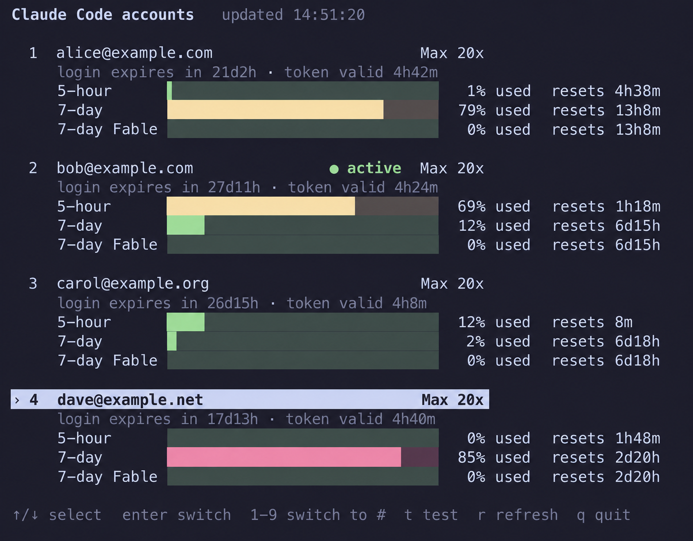

# Multi-Account Switcher for Claude Code

English | [繁體中文](README.zh-TW.md)

A simple tool to manage and switch between multiple Claude Code accounts on macOS, Linux, and WSL.

> This is a maintained fork of [ming86/cc-account-switcher](https://github.com/ming86/cc-account-switcher), which has been archived. It adds a usage dashboard and renews a login before switching to it.

## Features

- **Multi-account management**: Add, remove, and list Claude Code accounts
- **Quick switching**: Switch between accounts with simple commands
- **Cross-platform**: Works on macOS, Linux, and WSL
- **Secure storage**: Uses system keychain (macOS) or protected files (Linux/WSL)
- **Settings preservation**: Only switches authentication - your themes, settings, and preferences remain unchanged
- **Usage dashboard**: See every account's login expiry and 5-hour/7-day usage, and switch from the same screen
- **Safe switching**: An expired target login is renewed before the switch; a dead login stops the switch and leaves the current account in place

## Installation

Install the latest release (to `~/.local/bin/ccswitch`):

```bash
curl -fsSL https://github.com/wayne930242/cc-account-switcher/releases/latest/download/install.sh | bash
```

The installer downloads the release's `ccswitch` and verifies its SHA256 checksum before installing it. Options:

```bash
# A specific version, into another directory
curl -fsSL https://github.com/wayne930242/cc-account-switcher/releases/latest/download/install.sh | bash -s -- --version v1.0.0 --dir ~/bin
```

`--version`, `--dir`, and `--name` can also be set with `CCSWITCH_INSTALL_VERSION`, `CCSWITCH_INSTALL_DIR`, and `CCSWITCH_INSTALL_NAME`.

Update an installed copy in place:

```bash
ccswitch --self-update          # latest release
ccswitch --self-update v1.0.0   # a specific release
ccswitch --version
```

Releases are listed on the [Releases page](https://github.com/wayne930242/cc-account-switcher/releases).

## Usage

### Basic Commands

```bash
# Add current account to managed accounts
ccswitch --add-account

# List all managed accounts
ccswitch --list

# Switch to next account in sequence
ccswitch --switch

# Switch to specific account by number or email
ccswitch --switch-to 2
ccswitch --switch-to user2@example.com

# Remove an account
ccswitch --remove-account user2@example.com

# Interactive usage dashboard
ccswitch --dashboard

# Check that tokens really work (all accounts, or one)
ccswitch --test
ccswitch --test 2

# Show help
ccswitch --help
```

### Dashboard



`--dashboard` shows each managed account with:

- **Login expiry**: when the stored login (refresh token) lapses and you must log in again
- **Token state**: whether the access token is valid, was just renewed, or the login is dead
- **5-hour and 7-day usage**: percent used, with the time until each window resets, plus any per-model weekly limits

Keys: `↑`/`↓` (or `j`/`k`) select, `Enter` switches to the selected account, `1`-`9` switch to that account number, `t` tests the selected account (see below), `r` reloads, `q` quits. Every switch asks for confirmation. The screen reloads every 5 minutes and fits itself to the terminal: in a small window it narrows and, when not every account fits, scrolls to keep the selected one in view.

When there is room, Clawd, the Claude Code crab, sits beside the title in Claude's orange: it blinks, glances around, and walks sideways now and then, and shuffles its legs while the dashboard refreshes, tests, or switches. It steps aside on its own when the terminal is too small to show every account under it. The idea comes from [clawd-line](https://github.com/quazar-queso/clawd-line).

To show usage for inactive accounts, the dashboard renews an inactive account's expired access token and saves the result back to that account's backup. It never renews the active account's live token, because Claude Code holds it; when that token has expired, the dashboard says so and Claude Code renews it on its next request.

When stdin or stdout is not a terminal, `--dashboard` prints one snapshot and exits, so it also works in scripts. Set `NO_COLOR` to disable colors.

#### In Herdr

The [Herdr](https://herdr.dev) plugin in `herdr-plugin/` opens the dashboard in a centered popup that leaves your panes alone; quitting it closes the popup.

```bash
herdr plugin install wayne930242/cc-account-switcher/herdr-plugin
```

Then bind its action in `~/.config/herdr/config.toml`:

```toml
[[keys.command]]
key = "prefix+u"
type = "plugin_action"
command = "wayne930242.ccswitch.dashboard"
description = "open the ccswitch dashboard"
```

The plugin runs `$CCSWITCH_BIN` if set, else `ccswitch` on `PATH`, `~/.local/bin/ccswitch`, `~/bin/ccswitch`, or `~/bin/ccswitch.sh`, else the release bundled with the plugin. It puts `/opt/homebrew/bin` and `/usr/local/bin` first on `PATH`, so a Herdr started from a macOS app still finds Bash 4.4+ and `jq`.

### Token Test

`--test [num|email]` checks that a stored token actually works, not just that it has not expired: it sends one tiny prompt to Haiku with `claude -p`, using that account's access token through `CLAUDE_CODE_OAUTH_TOKEN`. Without an argument it tests every account in parallel and exits non-zero when any test fails. The test runs in an empty directory with no settings, MCP servers, or tools. It needs the `claude` CLI on `PATH` and uses a few tokens of each account's quota.

### First Time Setup

1. **Log into Claude Code** with your first account (make sure you're actively logged in)
2. Run `ccswitch --add-account` to add it to managed accounts
3. **Log out** and log into Claude Code with your second account
4. Run `ccswitch --add-account` again
5. Now you can switch between accounts with `ccswitch --switch`
6. **Important**: After each switch, restart Claude Code to use the new authentication

> **What gets switched:** Only your authentication credentials change. Your themes, settings, preferences, and chat history remain exactly the same.

## Requirements

- Bash 4.4+
- `jq` (JSON processor)
- `curl` (login renewal and the usage dashboard)
- `claude` (only for `--test` and the dashboard's `t` key)

### Installing Dependencies

**macOS:**

```bash
brew install bash jq
```

macOS ships Bash 3.2, so install a newer one with Homebrew.

**Ubuntu/Debian:**

```bash
sudo apt install jq curl
```

## How It Works

The switcher stores account authentication data separately:

- **macOS**: Credentials in Keychain, OAuth info in `~/.claude-switch-backup/`
- **Linux/WSL**: Both credentials and OAuth info in `~/.claude-switch-backup/` with restricted permissions

When switching accounts, it:

1. Renews the target account's login when its access token expires within an hour, and stops without changing anything when the login is dead
2. Backs up the current account's authentication data
3. Restores the target account's authentication data
4. Updates Claude Code's authentication files

A target token with more than an hour left is kept as is: renewing rotates the refresh token, which would break any running session that still holds the old one.

## Troubleshooting

### If a switch fails

- Check that you have accounts added: `ccswitch --list`
- Read the error message: when the target login has expired or was revoked, log in to Claude Code with that account and run `--add-account`
- Try switching back to your original account

### If you can't add an account

- Make sure you're logged into Claude Code first
- Check that you have `jq` and `curl` installed
- Verify you have write permissions to your home directory

### If Claude Code doesn't recognize the new account

- Make sure you restarted Claude Code after switching
- Check the current account: `ccswitch --list` (look for "(active)")

## Cleanup/Uninstall

To stop using this tool and remove all data:

1. Note your current active account: `ccswitch --list`
2. Remove the backup directory: `rm -rf ~/.claude-switch-backup`
3. Delete the script: `rm ccswitch.sh`

Your current Claude Code login will remain active. On macOS, also delete the Keychain items named "Claude Code-Account-…", which removing the backup directory leaves behind.

## Security Notes

- Credentials stored in macOS Keychain or files with 600 permissions
- Authentication files are stored with restricted permissions (600)
- Login renewal and usage requests send tokens through stdin, and `--test` passes them through the environment, never as command arguments. Saving credentials to the macOS Keychain still passes them to `security -w` as an argument, so they briefly appear in the process list, as in the original script

## Development

The source is split into modules under `lib/`, loaded in file-name order. `bin/ccswitch` runs them directly from a checkout (`ccswitch --version` prints `dev`), and `scripts/build.sh <version>` assembles them into the single file `dist/ccswitch` plus `dist/ccswitch.sha256`.

```
bin/ccswitch        development entry point
lib/*.sh            modules: config, environment, storage, registry, OAuth, commands, token test, dashboard, update, main
scripts/build.sh    builds the release file
install.sh          bootstrap installer attached to every release
tests/run.sh        offline regression tests
```

`bash tests/run.sh` runs the offline regression tests: each one uses a sandbox `HOME` with the file-based credential store and stub `curl` and `claude` commands, so it never touches a real Keychain, account, or network. `CCSWITCH_SCRIPT=dist/ccswitch bash tests/run.sh` runs them against a built file.

To release, push a tag such as `v1.2.0`. The release workflow builds `dist/ccswitch` with that version, runs shellcheck and the tests against it, and publishes a GitHub release with `ccswitch`, `ccswitch.sha256`, and `install.sh`.

## License

MIT License - see LICENSE file for details
